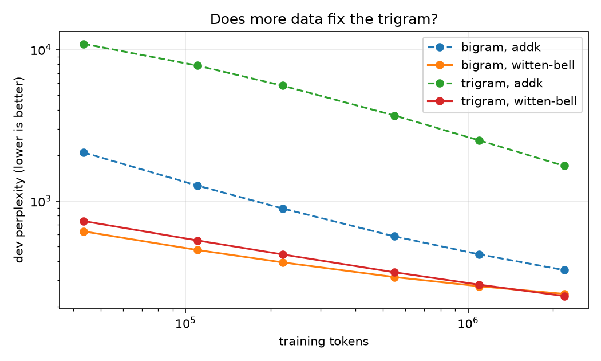

# Predictive-text engine: an n-gram language model from scratch

A smoothed n-gram language model in pure Python (standard library only). Fit it
on any text, then **suggest the next word**, **autocomplete a partial word**,
**generate** text, and **score** text with **perplexity**.

```python
from ngram_lm import NgramLM

lm = NgramLM(n=3, k=0.01, smoothing="witten-bell", min_count=2).fit(open("data/corpus.txt").read())
lm.suggest_next("she looked at")   # ['me', 'the', 'her']
lm.complete("my dear mis")         # ['miss', ...]  (finishes the word you're typing)
lm.generate(seed=4)                # a sampled sentence, reproducible per seed
lm.perplexity(held_out_text)       # 233.5
```

## What's in here

| Requirement | Where |
|---|---|
| Counts → probabilities | `ngram_lm/model.py` (`build`, `NgramLM.prob`) |
| Generation (bigram vs trigram) | `NgramLM.generate`, samples in `results/samples.txt` |
| Smoothing | add-k and Witten-Bell interpolated back-off (`NgramLM._addk`, `_witten_bell`), plus `<unk>` for rare/unseen words |
| Perplexity on a held-out split | `NgramLM.perplexity`, `ngram_lm/data.py`, `scripts/run_experiments.py` |
| Stretch: autocomplete UI | `app.py` (terminal REPL and a web box) |

## Run it

```bash
python scripts/download_data.py      # fetch ~2.7M words of Project Gutenberg novels into data/
python scripts/run_experiments.py    # reproduces every table below (~15 min; needs matplotlib for the plot)
python -m unittest discover -s tests # 17 tests
python app.py cli                    # type a phrase, see suggestions
python app.py web                    # autocomplete box at http://127.0.0.1:8000
```

## Method

* **Corpus**: 20 public-domain novels from Project Gutenberg (Austen, Dickens, Brontë, Twain, Stoker, Shelley, Doyle, …): 2.7M word tokens, 166k sentences.
* **Split**: sentences shuffled (seed 0) and split 80/10/10 into train / dev / test. Dev is used to choose `k`; the test split is evaluated once at the end.
* **Tokens**: lower-cased `[a-z']+` words, curly apostrophes normalised. Sentences are split on `. ! ?` (so "Mr." splits too; a known simplification).
* **`<unk>`**: words seen fewer than 2 times in training become `<unk>`, so held-out text with new words still gets non-zero probability.
* **Perplexity** = exp(−mean log P(word | context)) over every word plus the end-of-sentence marker. Lower is better; read it as "the model is choosing between roughly this many words at each step".

## Findings

### 1. Smoothing matters more than anything else

Dev perplexity (training on 2.19M tokens):

| smoothing | unigram | bigram | trigram |
|---|---|---|---|
| add-k, k=1 | 682.6 | 1,222.0 | 7,488.2 |
| add-k, best k (0.001–0.005) | 681.8 | 349.6 | 1,608.4 |
| **Witten-Bell back-off** | 681.8 | **243.4** | **235.6** |

Add-k hands every unseen word the same slice of probability, and with ~10k
words in the vocabulary that slice is huge for a trigram, where most contexts
have been seen only a handful of times. Even with `k` tuned down to 0.001 a
trigram is *4–7x worse than a bigram*. Interpolated back-off instead spends the
leftover probability on the shorter-context estimate, which is far more informed
than a uniform guess.

### 2. Does more data fix the trigram? Yes, but you need a lot of it



| train tokens | bigram (W-B) | trigram (W-B) |
|---|---|---|
| 44k | 629.5 | 736.4 |
| 220k | 393.1 | 443.7 |
| 548k | 314.1 | 338.0 |
| 1.1M | 273.3 | 279.9 |
| **2.2M** | 243.4 | **235.6** |

With back-off the trigram is *worse* than the bigram at every size up to ~1M
tokens (a trigram context is too sparse to be reliable), the gap shrinks
steadily as data grows, and the lines **cross between 1.1M and 2.2M tokens**.
On the held-out test split the final ranking is trigram **233.5** < bigram
**240.8** < unigram **677.1**. An earlier run on only 8 books (0.8M training
tokens) had the two tied, so the crossover is a data-size effect, not luck. Even
at the crossover the trigram's edge is small (about 3%); it needs far more data
before long contexts really pay off, which is the motivation for neural models.

### 3. Generation

From `results/samples.txt` (Witten-Bell, seeds 0–4):

* **bigram**: `the fulfilment even a solicitor general i'll b'lieve the door ain't she pushed some folks of a wasting candle and we have signed buckingham was obliged to be made it` (locally plausible, globally nonsense)
* **trigram**: `but it was not a very disappointing confession` (fluent, but pieces are often copied from training text, a symptom of sparse high-order counts)
* **unigram**: `lie won't had her with life comfort he was what cottage me in william through him relates morton pushed` (word soup)

### 4. Autocomplete (trigram, full corpus)

| typed | suggestions |
|---|---|
| `i do not` | know, think, mean |
| `it was a` | little, very, good |
| `my dear` | said, sir, copperfield |
| `she looked at` | me, the, her |

The model reflects its training data: "my dear **copperfield**" is there because
*David Copperfield* is in the corpus.

## Limitations / next steps

* No Kneser-Ney smoothing (it would likely lower perplexity further); Witten-Bell is parameter-free and simple.
* Chapter headings (e.g. "xxxii") and the mix of authors leak into the samples; cleaning per-book would help.
* Python dicts of `Counter`s are memory-hungry; the 2.7M-word corpus is about the practical limit for a trigram here without a more compact structure.

## Layout

```
ngram_lm/      the library (text.py, model.py, data.py)
scripts/       download_data.py, run_experiments.py
results/       results.md, samples.txt, learning_curve.png (generated)
tests/         unit tests
app.py         CLI + web autocomplete
```

Data is public-domain text from [Project Gutenberg](https://www.gutenberg.org/); it is downloaded, not committed.
