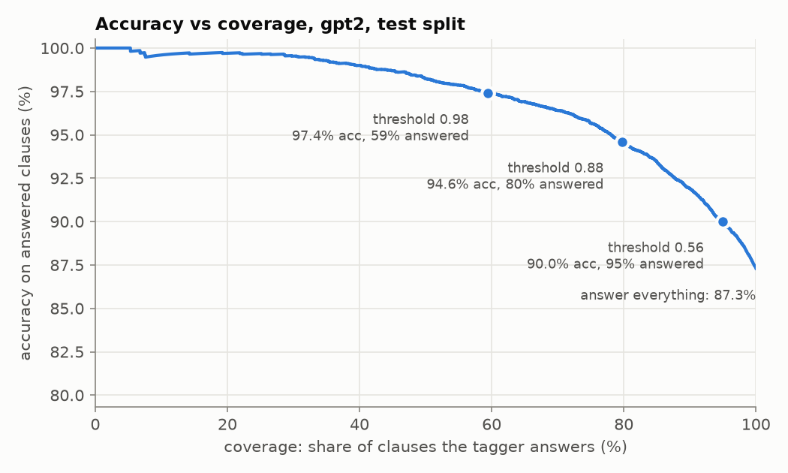
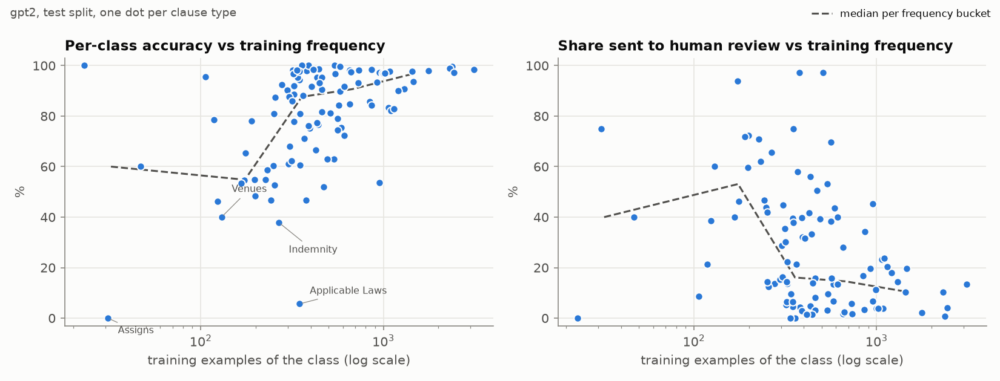
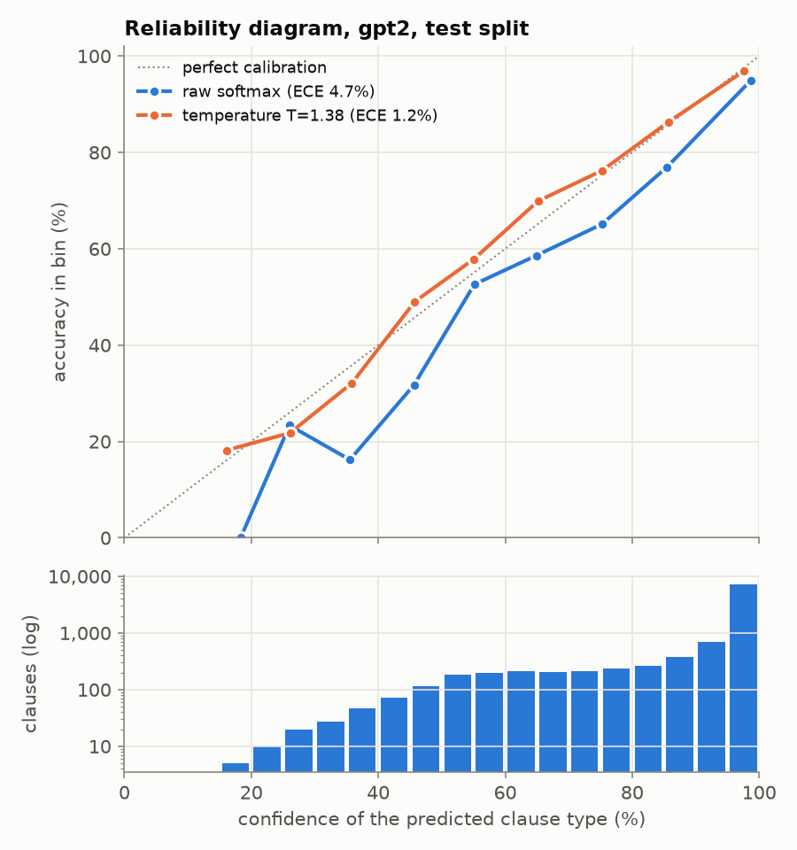
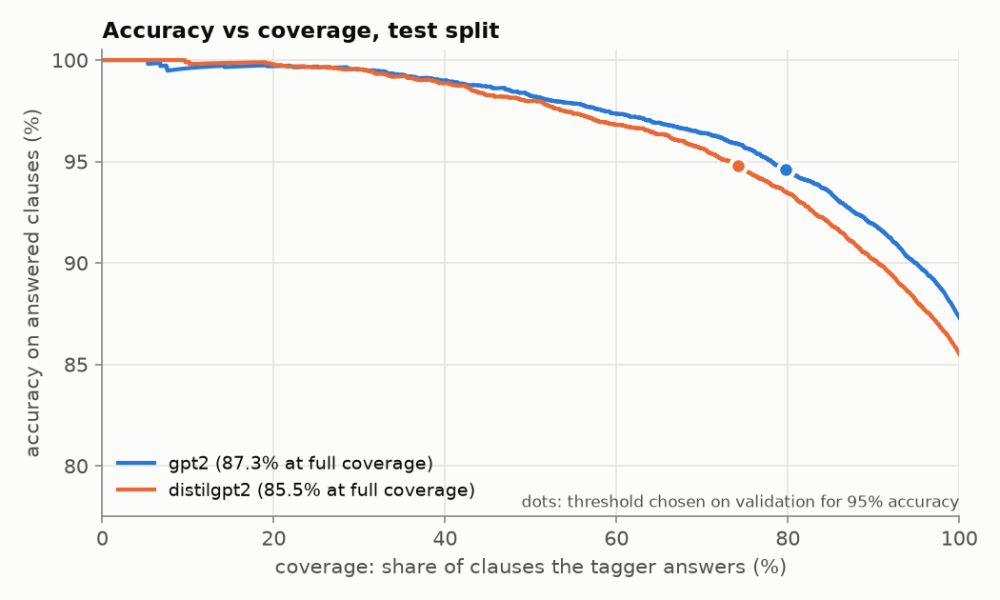

# Legal-Clause GPT: a contract-clause tagger that knows when it's unsure

GPT-2, fully fine-tuned with the Hugging Face Trainer, tags a contract clause with
one of the **100 LEDGAR clause types** (Governing Laws, Indemnifications,
Terminations, ...) and reports how confident it is. Below a confidence threshold
it still gives its best guess but flags the clause **"needs human review"**.

```python
from src.tagger import LegalClauseTagger

tagger = LegalClauseTagger("models/gpt2_n60k")
tagger.classify_clause("If any provision of this Agreement is held invalid or unenforceable, "
                       "the remaining provisions shall continue in full force and effect.")
# {'label': 'Severability', 'confidence': 0.996, 'needs_review': False,
#  'top3': [('Severability', 0.996), ('Enforceability', 0.002), ...]}
```

**Headline (test split, 10,000 clauses):** 87.3% accuracy, 80.6% macro-F1. With the
review threshold chosen on validation, the tagger answers **80% of clauses at 94.6%
accuracy** and sends the other 20% to a human.

## What's in here

| Requirement | Where |
|---|---|
| Course recipe: clause + `<label>` token, new label tokens, resized embeddings, pad-token fix, loss masked to the label position, argmax over label tokens | [`src/recipe.py`](src/recipe.py) |
| Full fine-tuning with the HF Trainer, on a GPU (Colab free tier T4) | [`src/train.py`](src/train.py), [`notebooks/train_colab.ipynb`](notebooks/train_colab.ipynb) |
| All 100 clause types; training-set size and its tradeoff | [`src/data.py`](src/data.py), [`scripts/data_stats.py`](scripts/data_stats.py), [Method](#method) |
| Held-out evaluation: accuracy, macro-F1, most confused pairs | [`src/evaluate.py`](src/evaluate.py), [`src/metrics.py`](src/metrics.py) |
| Confidence (softmax over the 100 label tokens), abstention, accuracy vs coverage | `src/metrics.py`, [Finding 2](#2-abstention-trading-coverage-for-accuracy) |
| Rare-class analysis: per-class accuracy vs training frequency | [Finding 3](#3-rare-classes-worse-and-the-model-knows-it) |
| `LegalClauseTagger.classify_clause(clause)` returning label + confidence | [`src/tagger.py`](src/tagger.py), [`scripts/demo_tagger.py`](scripts/demo_tagger.py) |
| Extra: distilgpt2 vs gpt2 | [`scripts/compare_runs.py`](scripts/compare_runs.py), [Finding 5](#5-distilgpt2-vs-gpt2) |
| Extra: calibration check | [Finding 4](#4-calibration-are-90-confident-predictions-right-90-of-the-time) |

## Run it

Training needs a GPU; everything after it runs on a laptop CPU from the saved logits.

```bash
pip install -r requirements.txt
python scripts/download_data.py          # LEDGAR from the HF Hub into data/ (27 MB)
python scripts/data_stats.py             # imbalance, duplicates, clause lengths -> outputs/data_stats.txt
python -m unittest discover -s tests     # 31 tests, tiny random GPT-2, CPU, ~20 s

# on a GPU (or open notebooks/train_colab.ipynb in Colab, T4 runtime):
python -m src.train --base gpt2          # 51 min on a T4 -> outputs/runs/gpt2_n60k/
python -m src.train --base distilgpt2    # 34 min          -> outputs/runs/distilgpt2_n60k/

# anywhere, from the saved logits:
python -m src.evaluate --run gpt2_n60k --model-dir models/gpt2_n60k   # report.md + plots; stores the review threshold
python -m src.evaluate --run distilgpt2_n60k
python scripts/compare_runs.py gpt2_n60k distilgpt2_n60k
python scripts/demo_tagger.py --model-dir models/gpt2_n60k             # needs the fine-tuned model (~500 MB)
python -m src.tagger --model-dir models/gpt2_n60k "The parties shall cooperate in good faith."
```

The fine-tuned weights are not in git (500 MB). The logits the evaluation needs
are (`outputs/runs/*/{val,test}_logits.npz`), so every number below can be
reproduced without a GPU.

## Method

* **Data.** [LEDGAR](https://huggingface.co/datasets/coastalcph/lex_glue) (LexGLUE): clauses from SEC-filed
  contracts, labelled with one of 100 types taken from the clause's heading.
  Official splits: 60,000 train / 10,000 validation / 10,000 test.
  920 exact repeats in train (after lower-casing and collapsing whitespace) are dropped, leaving 59,080.
* **How much to train on.** The plan was a 20k stratified subset, which would
  have left the rarest classes with 10 examples. A smoke test on the T4 showed
  training was fast enough to use everything: **all 59,080 clauses, 3 epochs, 51 min
  for gpt2**. The tradeoff is about 3x the time of the 20k subset for 2-3x
  more examples of every rare class. The class imbalance stays natural:
  23 to 3,124 examples per class (136x), median 420.
* **Clause length.** In GPT-2 tokens, clauses have a median of 106 and a 95th percentile of 388.
  `max_len = 384` fits 95% of clauses uncut (256 would fit 85%). Longer clauses keep their
  beginning. The prompt suffix and label are always kept.
* **Recipe** ([`src/recipe.py`](src/recipe.py)). Each example is
  `<clause tokens> "\nClause type:" <label token>`. The 100 label tokens (`<governing_laws>`, ...)
  are added to the tokenizer as special tokens, and the embedding matrix is resized.
  GPT-2 ties its output layer to these embeddings. Each new row starts as the mean embedding of the
  label's name rather than noise. The end-of-text token doubles as the pad token.
  `labels` is -100 everywhere except the label position, so the only prediction scored
  is the one made at `:`. Cross-entropy is over the full vocabulary plus the 100 label tokens.
* **Training.** Full fine-tuning (every weight) with the HF `Trainer`: AdamW,
  lr 5e-5 for gpt2 and 1e-4 for distilgpt2, linear decay with 6% warmup, batch 16,
  fp16 on a T4. Batches are grouped by length. After each epoch, label-position loss
  on a fixed 2,000-clause slice of validation picks the best checkpoint
  (gpt2: epoch 3, val loss 0.608 → 0.549 → 0.549; distilgpt2: epoch 2).
* **Prediction and confidence.** Run the prompt, take the hidden state at its last
  token, and score it against the 100 label-token rows only. Argmax gives the clause type.
  Softmax over those 100 scores gives the confidence, so the model can only answer with a valid type.
* **Honest evaluation.** Validation is used for everything that is chosen: the checkpoint,
  the review thresholds and the calibration temperature. Test is only ever scored.
  2.8% of test clauses also occur verbatim in train, so accuracy is also reported on the other 97.2%.

## Findings

All numbers are for gpt2 on the test split unless stated otherwise. The full
reports with every table are in [`outputs/runs/gpt2_n60k/report.md`](outputs/runs/gpt2_n60k/report.md)
and [`outputs/runs/distilgpt2_n60k/report.md`](outputs/runs/distilgpt2_n60k/report.md).

### 1. Overall: 87.3% accuracy, on par with BERT-style baselines

| | accuracy | macro-F1 |
|---|---|---|
| validation | 87.0% | 79.3% |
| **test** | **87.3%** | **80.6%** |
| test, clauses never seen verbatim in training (9,718) | 87.0% | 80.3% |
| test, clause cut to fit max_len (500) | 88.8% | |

For context, these are LEDGAR results for 12-layer encoders fine-tuned as classifiers, from the
[LexGLUE leaderboard](https://github.com/coastalcph/lex-glue). For single-label classification, micro-F1 is the same as accuracy.

| model | micro-F1 (= accuracy) | macro-F1 |
|---|---|---|
| TF-IDF + SVM | 87.0 | 81.4 |
| BERT | 87.6 | 81.8 |
| RoBERTa | 87.9 | 82.3 |
| Legal-BERT | 88.2 | 83.0 |
| **this project: GPT-2, answering with a label token** | **87.3** | **80.6** |

The leaderboard models use the full 60k train split and up to 512 tokens. A
decoder that names the class as its next token gets within about a point of them on accuracy,
and 1.2-2.4 points below on macro-F1.
TF-IDF + SVM already reaches 87.0, which suggests much of LEDGAR can be solved from vocabulary alone.
Accuracy on never-seen clauses (87.0%) matches the overall number, so the score
does not come from memorised boilerplate. Truncated clauses are not worse.

> **My analysis:** What surprised me is how little the architecture matters here. A left-to-right
> language model that has to *say* the class as its next token ends up within a point of
> bidirectional encoders with a classification head. TF-IDF is only 0.3 points behind it.
> When a bag of words, BERT, Legal-BERT and GPT-2 all land between 87 and 88%, the limit is
> probably the labels rather than the models (see Finding 3). The model-dependent part shows up in
> macro-F1. There the encoders lead by 1-2 points, so the rare clause types are where a
> stronger or legal-domain model would still pay off.

### 2. Abstention: trading coverage for accuracy

The confidence is the softmax probability of the predicted clause type. Each threshold below
is the lowest one that reaches the target accuracy **on validation**, applied unchanged to test:

| target accuracy | threshold | **test coverage** (answered) | **test accuracy** on answered | sent to review |
|---|---|---|---|---|
| 90% | 0.556 | 94.9% | 90.0% | 507 |
| **95%** (the tagger's default) | **0.881** | **79.8%** | **94.6%** | 2,024 |
| 98% | 0.983 | 59.4% | 97.4% | 4,063 |
| 99% | 0.995 | 48.4% | 98.4% | 5,156 |



Thresholds chosen on validation carry over to test: coverage is within 1.6 points of the
validation coverage, and accuracy lands 0-0.6 points below its target. The shortfall grows
at the top end, where the curve is steep and a small shift between splits costs a little accuracy.
Answering everything gives 87.3%, while sending the least confident 20% to a human gives 94.6%.

> **My analysis:** The number I'd show a legal team isn't the accuracy, it's the errors.
> Answering everything leaves 1,269 wrong tags in 10,000 clauses. At the default threshold, only 431
> wrong tags reach the user unreviewed, so **two thirds of all errors are caught** in exchange for a
> person reading 20% of the clauses. The review queue is also worth a reviewer's time: 838 of its 2,024
> clauses (41%) really are mistagged, against 13% across all clauses. And 57% of all errors have the
> right answer as the model's *second* choice. Showing the reviewer the top two tags would make most
> fixes a single click.

### 3. Rare classes: worse, and the model knows it



| training examples per class | classes | mean per-class accuracy | mean F1 | share sent to review |
|---|---|---|---|---|
| 23-49 | 3 | 53.3% | 53.3% | 38.3% |
| 100-249 | 14 | 59.7% | 61.8% | 52.6% |
| 250-499 | 44 | 80.2% | 81.7% | 25.2% |
| 500-999 | 24 | 87.0% | 85.9% | 24.2% |
| 1,000+ | 15 | 93.6% | 92.3% | 11.5% |

Per-class accuracy rises with training frequency (Spearman +0.48), and the share
sent to review falls (−0.38). Rare clause types are not silently wrong: about half of
their clauses are flagged. The 3 rarest classes have only 2-5 test clauses each, so their
row is noise.

Frequency is not the whole story. The ten worst classes include common ones that
are near-synonyms of a bigger class:

| clause type | train examples | accuracy | most often predicted as |
|---|---|---|---|
| Assigns | 31 | 0.0% (of 4) | Binding Effects |
| Applicable Laws | 348 | 5.7% | Governing Laws |
| Indemnity | 267 | 37.9% | Indemnifications |
| Venues | 130 | 40.0% | Governing Laws |
| Tax Withholdings | 377 | 46.7% | Withholdings |
| Miscellaneous | 472 | 51.9% | Entire Agreements |

**Most confused pairs** (both directions counted; the top 15 account for 30% of all 1,269 errors):

| clause type A | clause type B | A → B | B → A |
|---|---|---|---|
| Tax Withholdings | Withholdings | 34 | 17 |
| Applicable Laws | Governing Laws | 41 | 0 |
| Defined Terms | Definitions | 20 | 15 |
| No Waivers | Waivers | 17 | 14 |
| Binding Effects | Successors | 12 | 17 |
| Authority | Authorizations | 10 | 15 |
| Representations | Warranties | 9 | 15 |
| Amendments | Modifications | 3 | 18 |
| Entire Agreements | Integration | 1 | 18 |

Almost every pair is two headings for the same kind of clause. LEDGAR's labels come from
whatever heading the drafter used, so "Applicable Laws" and "Governing Laws" sections
contain essentially the same text, and the model sends 41 of the 53 "Applicable Laws" test clauses to the bigger class.
These are disagreements about naming more than misunderstandings of the clause.

> **My analysis:** The rare-class story is real but secondary. More training data clearly helps:
> accuracy climbs from about 55% to 94% across the frequency buckets. But the worst class,
> Applicable Laws, has 348 training examples, more than a third of all classes, and still scores 5.7%,
> because its clauses read exactly like Governing Laws. No amount of extra data fixes that; a cleaner
> label set would. If I were deploying this, I would merge the obvious synonym pairs
> (Withholdings / Tax Withholdings, Definitions / Defined Terms, Waivers / No Waivers, ...) before
> collecting a single extra example. The encouraging part is that the review rate rises as frequency falls,
> so the model behaves more cautiously on exactly the classes it has seen least.

### 4. Calibration: are 90%-confident predictions right 90% of the time?



| confidence | clauses | mean confidence | accuracy |
|---|---|---|---|
| 0.5-0.6 | 380 | 55.1% | 52.6% |
| 0.7-0.8 | 450 | 75.2% | 65.1% |
| 0.8-0.9 | 633 | 85.5% | 76.9% |
| 0.9-1.0 | 7,821 | 98.7% | 95.0% |

Almost, but not quite. The model is **mildly overconfident**: 92.0% mean confidence
vs 87.3% accuracy, ECE 4.7%. Predictions in the 0.8-0.9 band are right 77% of the time,
not 85%. Temperature scaling, a single number T = 1.38 fitted on validation that divides the logits,
brings test ECE down to **1.2%** and NLL from 0.513 to 0.465. It changes no prediction and no
ranking, so the coverage curve above is identical; it only makes the confidence numbers mean what they say.

> **My analysis:** Calibration matters less for the abstention rule than I expected. The threshold is
> picked by *measured* accuracy on validation, so it works whether 0.88 "means" 88% or not; all it needs
> is that higher confidence ranks clauses better, and it does. Calibration matters when a person reads
> the number. A reviewer told "85% confident" should be able to trust that roughly 85 in 100 such tags
> are right, and raw GPT-2 gets only 77. Since one fitted number fixes this almost completely,
> the tagger should report temperature-scaled confidence. That is a one-line change I'd make
> before anyone relies on the displayed number.

### 5. distilgpt2 vs gpt2

| | gpt2 | distilgpt2 |
|---|---|---|
| parameters (layers) | 124M (12) | 82M (6) |
| training time, T4 | 50.7 min | 33.5 min |
| test accuracy | **87.3%** | 85.5% |
| test macro-F1 | **80.6%** | 77.3% |
| coverage at 95% accuracy | **79.8%** | 74.2% |
| coverage at 98% accuracy | **59.4%** | 50.0% |
| ECE raw → temperature-scaled | 4.7% → 1.2% | 4.3% → 1.3% |



Half the layers cost 1.8 points of accuracy, 3.3 points of macro-F1, and 6-9 points of coverage at
the same accuracy target. The gap is widest on rare classes: in the 100-249-example bucket, distilgpt2 gets 48.0%
mean per-class accuracy vs gpt2's 59.7%. Training takes two thirds of the time. Both models are similarly
calibrated, and their errors are on the same synonym pairs.

> **My analysis:** The accuracy gap (1.8 points) understates the difference in practice. Both models
> reach 95% the same way, by sending clauses to review, but distilgpt2 needs to send 2,579 per
> 10,000 against gpt2's 2,024: about 550 more clauses for a person to read, for every 10,000 tagged.
> The gap grows the stricter the target (6 points of coverage at 95%, 9 at 98%), so the bigger model
> buys better *ranking* of its own confidence, not just more right answers. Training is a one-off
> 17 extra minutes and inference is cheap either way, so for a review workflow I'd pick gpt2.
> distilgpt2 only makes sense if inference speed or memory is the binding constraint.

### 6. The tagger on real clauses

From [`outputs/tagger_demo.md`](outputs/tagger_demo.md) (review threshold 0.881):

| clause | tag | confidence | |
|---|---|---|---|
| "...governed by and construed in accordance with the laws of the State of Delaware..." (hand-written) | Governing Laws | 0.975 | |
| "The Employee shall be entitled to twenty days of paid vacation per calendar year." (hand-written) | Vacations | 1.000 | |
| "No failure or delay on the part of AMSC or Subcontractor in the exercise of any power..." (true: No Waivers) | Waivers | 0.600 | **needs review**: wrong, and caught |
| "In the event of Participant's death prior to the Vesting Date, the Option will fully vest..." (true: Vesting) | Death | 1.000 | confidently "wrong" |

The last row shows what a confidence threshold can't catch. The clause is about vesting
*triggered by death*, and both labels are defensible. The model is sure, and the dataset disagrees.
Label ambiguity, not uncertainty, is the main source of confident errors.

> **My analysis:** "Knows when it's unsure" holds up, with one honest caveat. The review flag catches the
> model's *doubt*, but not *disagreements about naming* where the model is certain. Above 99% confidence the tagger is
> right 97.9% of the time, but that still leaves 115 confident errors per 10,000 clauses, and a
> quarter of all unreviewed errors (109 of 431) fall in the top confused synonym pairs. So the
> confidence score is a good triage signal, not a guarantee. The fix lives in the label set and in
> how results are shown (top two tags when they are known near-synonyms), not in a stricter threshold.

## Limitations / next steps

* **Label noise caps accuracy.** Many errors are synonym headings (Finding 3). Merging near-duplicate labels,
  or scoring "correct up to synonym", would measure the model better than its raw accuracy does.
* **One seed per model.** Differences under about 0.5 points (e.g. between the two models' ECE) are within run-to-run noise.
* **Confidence is a single softmax.** It can't flag the confidently-ambiguous case in Finding 6. Showing
  the runner-up when it is a known synonym would help a reviewer more than a threshold does.
* **The loss computes the full-vocabulary logits at every position**, even though only one is scored.
  That is the standard Trainer path, but a custom loss on the last position alone would train noticeably faster.
* **Truncation at 384 tokens** affects 5% of clauses and didn't hurt here. Longer contexts weren't tried.

## Layout

```
src/
  config.py      base-model presets, run Config (saved with every run)
  data.py        load splits, dedupe, stratified subset, seen-in-train mask
  recipe.py      label tokens, resize + pad fix, masked-label collator, label-token logits
  train.py       HF Trainer fine-tuning; saves val/test logits for evaluation
  metrics.py     accuracy, macro-F1, confused pairs, coverage, thresholds, ECE, temperature scaling
  evaluate.py    report.md, metrics.json, per_class.csv and plots for one run
  tagger.py      LegalClauseTagger.classify_clause / classify_clauses, CLI
scripts/         download_data, data_stats, compare_runs, demo_tagger, make_colab_zip
notebooks/       train_colab.ipynb: the exact Colab run
tests/           31 unit tests (tiny random GPT-2, no GPU, no download beyond the tokenizer)
outputs/
  data_stats.txt, comparison.md, coverage_comparison.png, tagger_demo.md
  runs/{gpt2,distilgpt2}_n60k/   config, summary, Trainer log, logits, report.md, per_class.csv, plots
```
