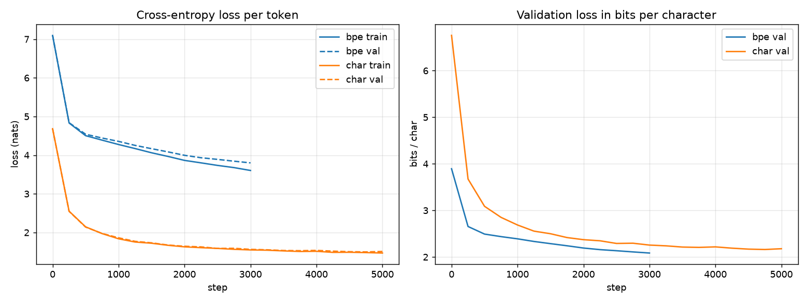

# Malayalam GPT: a transformer language model from scratch

A GPT written by hand in PyTorch (no `nn.MultiheadAttention`, no pretrained weights) and trained from scratch on CPU on Malayalam news/web text. It runs at character level and with a BPE tokenizer I implemented myself.

```python
from src.generate import MiniGPT

gpt = MiniGPT("outputs/char")   # or "outputs/bpe"
gpt.complete("കേരളത്തിൽ", max_new_tokens=200, temperature=0.8, top_p=0.9)
```

## What's in here

| Requirement | Where |
|---|---|
| Input pipeline: tokenizer, token + positional embeddings, batched (input, next-token) tensors | `src/tokenizer.py`, `src/data.py` (`get_batch`), `GPT.token_embedding` / `position_embedding` in `src/model.py` |
| Self-attention from scratch (masked scaled dot-product) | `Head` in `src/model.py`, plus `MultiHeadAttention`, `FeedForward`, `Block` |
| Transformer trained with next-token cross-entropy, loss falling | `src/train.py`, `outputs/*/loss.csv`, `outputs/loss_curve.png` (Finding 1) |
| Generation with temperature / top-k / top-p | `GPT.generate` in `src/model.py`, `src/generate.py`, `outputs/char/decoding_comparison.md` (Finding 3) |
| Originality: own corpus and cleaning, write-up | `src/clean.py`, `scripts/prepare_data.py`, `outputs/corpus_stats.txt`, `scripts/evaluate_samples.py`, this README |
| Stretch: BPE tokens | `src/bpe.py`, `scripts/train_bpe.py`, `scripts/compare_tokenizers.py` (Findings 4-5) |

## Run it

Commands run from `malayalam-gpt/`. The trained checkpoints (`outputs/char/model.pt`, `outputs/bpe/model.pt`) are committed, so `generate` works right after cloning, with no download.

```bash
python -m venv .venv && source .venv/bin/activate        # Windows: .venv\Scripts\activate
pip install torch --index-url https://download.pytorch.org/whl/cpu
pip install -r requirements.txt

python -m src.generate --prompt "കേരളത്തിൽ" --temperature 0.8 --top-p 0.9   # char model, uses the committed checkpoint
python -m src.generate --run bpe --prompt "കേരളത്തിൽ"                        # BPE model
python -m src.generate --compare --prompt "കേരളത്തിൽ"                        # rewrites outputs/char/decoding_comparison.md

# to reproduce everything from scratch:
python scripts/download_data.py        # stream ~25 MB of Malayalam text into data/raw.txt
python scripts/prepare_data.py         # clean + shuffle -> data/corpus.txt (8 MB)
python scripts/corpus_stats.py         # -> outputs/corpus_stats.txt
python -m src.train                    # char model, 5000 steps (~41 min on CPU)
python scripts/train_bpe.py            # 1024-token BPE, ~10 s
python scripts/compare_tokenizers.py   # -> outputs/tokenizer_comparison.md
python -m src.train --tokenizer bpe --run bpe --max-iters 3000   # ~28 min on CPU
python scripts/plot_loss.py            # -> outputs/loss_curve.png
python scripts/evaluate_samples.py     # -> outputs/sample_quality.md (real-word rate, script errors)
python -m unittest discover -s tests   # 26 tests
```

## Architecture

```
text -> tokens (char or BPE) -> token embedding + position embedding        (B, T, 128)
     -> 4 x [ LayerNorm -> masked multi-head attention -> + residual
              LayerNorm -> feed-forward (4x, ReLU)     -> + residual ]
     -> LayerNorm -> lm_head -> softmax -> distribution over the next token
```

Each `Head` projects the input to queries, keys and values (`head_size = n_embd // n_heads = 32`), scores every pair of positions with `q @ k.T`, scales by `head_size ** -0.5` so the softmax does not saturate, then sets everything above the diagonal (`tril == 0`) to `-inf` before the softmax so position *t* cannot see the future. The output is the attention-weighted sum of the values. Four heads are concatenated and projected back to `n_embd`. Training minimises cross-entropy between the logits at every position and the token one step to the right.

CPU preset (`src/config.py`): `block_size` 128, `n_embd` 128, 4 heads, 4 layers, dropout 0.1, AdamW at lr 1e-3, batch 32. The char model has 833,121 parameters; the BPE model has 1,071,360 (a bigger embedding and `lm_head` for a 1024-token vocabulary). An untrained model should score about `ln(vocab)`: 4.68 against ln 97 = 4.58 for char, 7.10 against ln 1024 = 6.93 for BPE.

## Dataset and cleaning

**Source**: the verified Malayalam split of [AI4Bharat Sangraha](https://huggingface.co/datasets/ai4bharat/sangraha), streamed (about 25 MB), then cleaned and cut to **8.0 MB, 2.9M characters, 9,839 paragraphs, vocabulary 97**. Split: first 90% / last 10% of the token stream for train / validation.

**Cleaning** (`src/clean.py`, a pure function with tests):

* Unicode NFC; legacy chillu (consonant + virama + ZWJ) becomes the atomic chillu letter; any remaining ZWJ/ZWNJ is dropped.
* Keep Malayalam letters and signs, digits (Malayalam digits mapped to ASCII) and basic punctuation; drop everything else.
* Drop lines under 70% Malayalam, under 20 characters, or duplicated.
* Shuffle paragraphs (seed 0) before cutting to 8 MB, so topics mix and the 90/10 split is representative.
* Known quirk: some sources write chillu as ര്/ല്/ള് without a ZWJ. I left these alone because word-final ന് (as in ഇന്ന്) is legitimate, so the corpus has both spellings.

**Why character-level Malayalam is hard.** One visible letter is often several code points: ക്ഷേത്രം is 8 tokens (ക ് ഷ േ ത ് ര ം). The virama is the most frequent character in the corpus (410,940 of 2.9M, about 14%). A word averages about 10 code points, so a 128-character context covers only about 12 words.

## Findings

### 1. The loss falls



Left: per-token loss (not comparable across tokenizers). Right: validation loss in bits per character. Char model, validation loss from `outputs/char/loss.csv`:

| step | train | val |
|---|---|---|
| 0 | 4.6835 | 4.6844 |
| 500 | 2.1462 | 2.1405 |
| 1000 | 1.8369 | 1.8623 |
| 2500 | 1.5884 | 1.5877 |
| 5000 | 1.4688 | 1.5092 |

Best validation loss is **1.4976** (step 4750; that checkpoint is the one saved) = 2.161 bits/char. Train and validation stay close, so there is no sign of memorising the training text.

### 2. Samples across training

Same prompt `കേരളത്തിൽ` ("In Kerala"), temperature 0.8, top-k 40, from `outputs/char/samples.txt`. Translations are rough and literal; *italics* mark invented words, with the real pieces they are built from where there are any.

* **step 0** (val 4.684): `കേരളത്തിൽിഈഹഞഊന ഠഔ`
  → random characters; vowel signs float with no consonant to attach to.
* **step 500** (val 2.141): `കേരളത്തിൽ ഇരുമായി വെപ്പനമായിരിക്കി. ആ പ്രസംസൂറ്റിക്കലും ചോരിച്ചു. എല്ലേ ബൂർ വല്ലീസ് അവമസ്റഹച്ചുകളും`
  → "In Kerala *irumaayi* *veppanamaayirikki*. That *prasamsoottikkal* too *chorichu*. *Elle boor vallees avamasrahachukal*." Almost no real words, but real endings (-മായി "as/with", -ിക്കലും "also the act of", -ുകളും "and the ...s") and sentence-final full stops.
* **step 2500** (val 1.588): `കേരളത്തിൽ ഒരു വൈകുവാൻ കയറ്റാണ് കാരണം പ്രതികരണമാണ് വേണ്ടി വകലവാഹ സ്വദേശികളും വെള്ളക്ക് വിവിധ മാവാക്കിയത്.`
  → "In Kerala, a to-be-late is a *climb*; the reason is a response; for the *vakalavaaha* natives and *vellakk*, various [things] were *made into flour*." Mostly real words, no meaning.
* **step 5000** (val 1.509): `കേരളത്തിൽ അപകടവുമായി ഉപയോഗിച്ചു. സി.. എസ്. പി. ഫ്രസ് കേരള 10 മരുന്ന് മാത്രം ചെയ്തു.` / `ഇന്ത്യ ചെന്നൈസ് ഫലി പരിപാടി പറഞ്ഞു.`
  → "In Kerala, used with an accident. C.. S. P. *Fras* Kerala did only 10 medicines." / "India *Chennais* *phali* programme said." Real words, news vocabulary and abbreviations, verb-final sentences; still no meaning.

### 3. Decoding: temperature, top-k, top-p

Same prompt, same seed, 250 new tokens, char model (`outputs/char/decoding_comparison.md`, first sentence of each):

* **temperature 0.5**: `കേരളത്തിൽ അമ്മയിൽ കൃത്യമാണ്. ക്രൈംബ്രാഞ്ച് വിട്ടപ്പോൾ ജയറാഖ് അറിയിച്ചു. ഇതിന്റെ സ്വദേശിക്കാതെയാണ് കുടുംബത്തിൽ ജയിലിൽ നിന്ന് കോടതിയിലെ ഉണ്ടായത്.`
  → "In Kerala, in the mother, it is exact. When the Crime Branch left, *Jayarakh* informed. It is without *native-ing* this that, in the family, from jail, the court's [one] happened."
* **temperature 1.0**: `കേരളത്തിൽനിന്നും സംഭവം, ഫ്ര്വാം കോടതിയിൽ ഗവന്തര പൊലീസിലും നഗര്ശനങ്ങൾ കാണുന്ന ഇരു പാസത്ത് വരുമോ മാറ്റം നൽകിയത്.`
  → "From Kerala, the incident, *frvaam* in court, also in the *gavanthara* police, seeing *nagarshanangal*, will the two *paasath* come, gave the change."
* **temperature 1.4**: `കേരളത്തിൽനിന്നും സബ്. ഹിഫ്ര്: ആറോപ്പ്യക്കഗറിറ്റിംഗ്, ദൃശ്യനഗരൻഡൽ ജമങേക്കൽ, നസുരക്ഷാസത്ത് 614:6 മാംയദിൽ`
  → "From Kerala, sub. *Hifr*: *aaroppyakkagarittimg*, *drishyanagarandal* (visual + city + ...), *jamangekkal*, *nasurakshaasath* (... security ...) 614:6 *maamyadil*." Mostly non-words.
* **top-k 10** (temp 1.0): `കേരളത്തിൽനിന്നും സംഭവം, വിര്ദ്ദേശിക്കയിൽ നടന്നു പൊലീസിലും നിര്മ്മുണ്ടായിരുന്നു.`
  → "From Kerala, the incident took place in *virddeshikka* (≈ instructing), and in the police too there was *nirmmu* (≈ construction)."
* **top-p 0.9** (temp 1.0): `കേരളത്തിൽ അമ്മയിൽ എന്നാൽ അറ്റാലിക്കാരുടെ ഗുണമെന്നും ഉദ്യോഗസ്ഥൻ ചോദ്യം ഉറങ്ങുന്നതാണ്.`
  → "In Kerala, in the mother, but the *attaalikkaar*'s benefit, and the officer's question is sleeping."

Low temperature gives the most conventional news-style phrasing (reporting verbs like അറിയിച്ചു, common nouns), at the cost of variety. At 1.4 the text drifts into invented words, stray digits and punctuation. Top-k and top-p sit between the two. Because the seed is shared, the 0.5 and top-p 0.9 rows start identically, as do the 1.0 and top-k 10 rows, until the filtered distribution diverges.

### 4. Tokenizers: char vs my BPE vs GPT-2

20 held-out validation sentences (`outputs/tokenizer_comparison.md`):

| tokenizer | tokens / sentence | chars / token | validation tokens |
|---|---|---|---|
| char-level (97) | 88.4 | 1.00 | 290,938 |
| **our BPE (1024)** | **33.7** | **2.63** | 110,580 |
| GPT-2 (50257) | 243.9 | 0.36 | 798,182 |

GPT-2 is worse than characters here: a Malayalam character is 3 UTF-8 bytes and its vocabulary has almost no Malayalam merges, so one character often becomes several byte-fragment tokens. My BPE (`src/bpe.py`) merges code points rather than bytes, never merges across a word boundary, and trains in about 10 s on the 2.6M-character training split (927 merges). It learns frequent conjuncts and endings first (`ക്ക`, `ത്ത`, `ും`, `ിൽ`, `ാണ്`, `_പ്ര`); the last merges are whole words such as ` ദിവസം` and `ിട്ടില്ല`. First merges: `ന + ് -> ന്`, `ക + ് -> ക്`, `ത + ് -> ത്`, `ന് + ന -> ന്ന`.

Example (92 characters; 92 char tokens vs 38 BPE tokens):

```
char: ഇ|ത|ി|ൽ| |1| |വ|ര|്|ഷ|ത|്|ത|ി|ന|ു|ള|്|ള|ി|ൽ| |വ|ര|ു|ന|്|ന| |ആ|വ|ശ|്|യ|ങ|്|ങ|ൾ|ക|്|ക|്| ...
BPE:  ഇ|തി|ൽ| 1| വര്|ഷ|ത്തിന|ുള്ള|ിൽ| വ|രുന്ന| ആവശ്യ|ങ്ങൾ|ക്ക്| 2|5|,| 3|0| മാ|സ| കാല|ാവ|ധ|ിയ|ുള്ള| ഹ|്ര|സ്|വ|ക|ാല| ച|ിട്ട|ികൾ| ചേ|ര|ാം
```

### 5. Char GPT vs BPE GPT

Per-token losses are not comparable across tokenizers, so I compare bits per character: `loss / ln 2 / chars_per_token`. For BPE this uses the average 2.63 chars/token, so it is approximate.

| | char | BPE |
|---|---|---|
| vocab | 97 | 1,024 |
| parameters | 833,121 | 1,071,360 |
| steps | 5,000 | 3,000 |
| wall time (CPU) | 40.7 min | 27.6 min |
| best val loss (per token) | 1.498 | 3.801 |
| **val bits / char** | 2.161 | **2.085** |

BPE reaches a lower bits/char in fewer steps and less time, and its curve was still going down at step 3000, so an equal-length run might widen the gap. A BPE sample (`outputs/bpe/samples.txt`, step 3000, first lines):

> കേരളത്തിൽ അവിടെ കാണപ്പെടുന്നതായിരുന്നു.
> കൊവിഡ് വാഹനങ്ങളുടെ ആവശ്യം നടപ്പും നമുക്ക് ശബ്ദങ്ങളും പകർണ്ണമായും ശക്തിപരമായും സൃഷ്ടിക്കൊണ്ട് നിക്ഷേപം നൽകി.

→ "In Kerala, it was being seen there. / The need for Covid vehicles, the *implementation*, and for us sounds, *pakarnnamaayi* and powerfully, *creating*, gave investment." At temperature 0.5 it produces `പ്രധാനമന്ത്രി നരേന്ദ്ര മോദി` ("Prime Minister Narendra Modi"), a three-word name spelled perfectly, because each word is a handful of BPE tokens it has seen together many times.

## What it learned vs what it didn't

Two things can be measured without reading the output (`scripts/evaluate_samples.py` → `outputs/sample_quality.md`, ~3,000 generated characters per row, 5 prompts):

| model | decoding | real words | script errors / 100 words |
|---|---|---|---|
| real validation text | | 72% | 0.1 |
| char | temp 0.5 | 81% | 0.7 |
| char | temp 0.8, top-k 40 | 57% | 0.6 |
| char | temp 1.4 | 23% | 2.6 |
| BPE | temp 0.5 | 72% | 0.3 |
| BPE | temp 0.8, top-k 40 | 58% | 0.3 |
| BPE | temp 1.4 | 41% | 1.3 |

*Real words* is the share of generated words that also occur in the training text. Even genuine held-out text only scores 72%, because Malayalam glues suffixes onto words and many correct forms are simply rare. *Script errors* are sign sequences no real word can have (a vowel sign or virama starting a word, two vowel signs in a row).

**What it learned**

* **The writing system.** At step 0 vowel signs float with nothing to attach to. After training there is under one impossible sequence per 100 words at normal settings: it puts vowel signs after consonants, builds conjuncts with the virama (ക്ക, ത്ത, ന്ന, ഞ്ഞ) and ends words with chillu letters. It learned this from code points alone, with no rule written down.
* **Word endings.** Stems carry real case and tense endings: -ിൽ (in), -ന്റെ (of), -ക്ക് (to), -ും (and/also), past tense -ിച്ചു. Sentences end with a verb and a full stop, the normal Malayalam subject-object-verb order.
* **The vocabulary and register of news.** Court, police, Crime Branch, jail, Covid, "informed" (അറിയിച്ചു), "said" (പറഞ്ഞു): the reporting verbs that close Malayalam news sentences. The BPE model spells multi-word names like പ്രധാനമന്ത്രി നരേന്ദ്ര മോദി correctly.
* **Temperature works as expected.** Low temperature keeps to frequent words (81% real at 0.5, above real text, since it avoids rare forms), high temperature invents (23% at 1.4).

**What it didn't**

* **Meaning.** Sentences look grammatical but say nothing: "the officer's question is sleeping". Subjects and verbs don't agree in sense.
* **A reliable lexicon.** At normal settings about 4 in 10 words are not in the training text. Some are valid rare forms, many are inventions stitched from real pieces (സ്വദേശിക്കാതെ, നിര്മ്മുണ്ടായിരുന്നു). It knows how Malayalam words are *built* better than which words *exist*.
* **Coherence.** Topics drift from sentence to sentence. The char model sees about 12 words of context; BPE about 3x more, which helps spelling but not yet meaning.
* **BPE helps where tokens help.** BPE makes fewer script errors (0.3 vs 0.6 per 100 words) because many signs come pre-attached inside its tokens, but its real-word rate at normal settings is about the same (58% vs 57%).

## Limitations / next steps

* **Small and CPU-only**: about 1M parameters, 128-token context (about 12 words for the char model), about 40 minutes of training. The text is locally plausible but not meaningful.
* **Corpus skew**: the corpus is news-heavy and shows its era (COVID/lockdown vocabulary, sports, crime reports), so the model writes news-flavoured text whatever the prompt.
* **Chillu inconsistency**: both ര്/ല്/ള്-style and atomic chillu spellings occur in the corpus, so the model learns both.
* **BPE run is shorter and was still improving**: 3,000 steps against 5,000 for char, and the bits/char conversion is approximate.
* **Next**: a larger model on a GPU (the `cuda` and `mps` presets are already in `src/config.py`), a longer BPE run, a learning-rate schedule (warmup + decay), and a more diverse corpus (literature, Wikipedia, speech transcripts).

## Layout

```
src/        config.py, tokenizer.py (char), bpe.py, clean.py, data.py, model.py (the GPT), train.py, generate.py
scripts/    download_data.py, prepare_data.py, corpus_stats.py, train_bpe.py, compare_tokenizers.py, plot_loss.py, evaluate_samples.py
tests/      26 unit tests (cleaning, tokenizers, BPE, model)
outputs/    corpus_stats.txt, tokenizer_comparison.md, bpe_report.txt, loss_curve.png, bpe_vocab.json, sample_quality.md
  char/     model.pt, vocab.json, config.json, loss.csv, samples.txt, decoding_comparison.md, train.log
  bpe/      same files for the BPE run
data/       raw.txt, corpus.txt (generated, not committed)
```

The corpus is downloaded, not committed. Data: [AI4Bharat Sangraha](https://huggingface.co/datasets/ai4bharat/sangraha) (see the dataset page for its license and credit).
