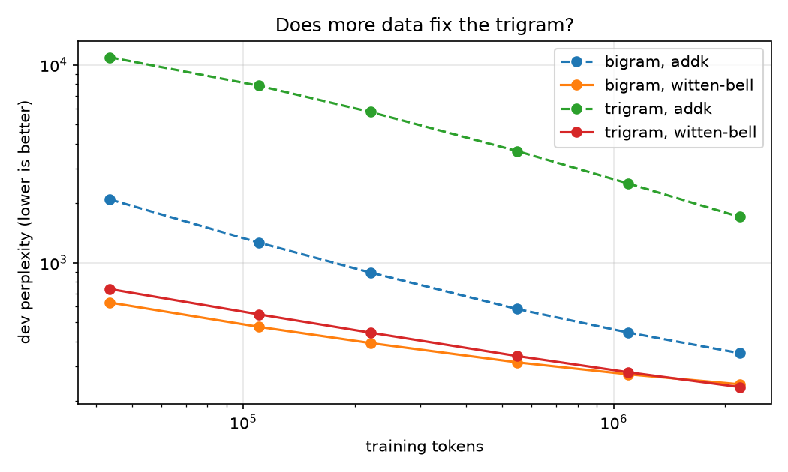

# Results

Corpus: 2,735,241 word tokens in 166,160 sentences (Project Gutenberg novels). Split by sentence 80/10/10 (seed 0): train 2,187,732, dev 272,577, test 274,932 tokens. Words seen <2x in training are mapped to `<unk>`.

## 1. Dev perplexity: order n vs smoothing k

Lower is better. Unigram / bigram / trigram:

| smoothing | n=1 | n=2 | n=3 |
|---|---|---|---|
| k=1 | 682.6 | 1,222.0 | 7,488.2 |
| k=0.5 | 682.1 | 899.2 | 5,929.8 |
| k=0.1 | 681.8 | 519.8 | 3,420.6 |
| k=0.05 | 681.8 | 442.7 | 2,760.9 |
| k=0.01 | 681.8 | 359.3 | 1,886.2 |
| k=0.005 | 681.8 | 349.6 | 1,706.9 |
| k=0.001 | 681.8 | 368.2 | 1,608.4 |
| **Witten-Bell** (back-off) | 681.8 | 243.4 | 235.6 |

## 2. Test perplexity (k chosen on dev, test touched once)

| n | smoothing | test perplexity |
|---|---|---|
| 1 | add-k (k=0.001) | 677.1 |
| 1 | Witten-Bell | 677.1 |
| 2 | add-k (k=0.005) | 346.5 |
| 2 | Witten-Bell | 240.8 |
| 3 | add-k (k=0.001) | 1,598.2 |
| 3 | Witten-Bell | 233.5 |

## 3. Does more data fix the trigram?

Dev perplexity as the training set grows (fixed vocabulary; k re-tuned per size for add-k).

| train fraction | tokens | bigram add-k | bigram W-B | trigram add-k | trigram W-B |
|---|---|---|---|---|---|
| 2% | 43,627 | 2,090.8 | 629.5 | 10,922.0 | 736.4 |
| 5% | 109,960 | 1,265.1 | 474.7 | 7,851.9 | 549.0 |
| 10% | 220,384 | 892.6 | 393.1 | 5,782.1 | 443.7 |
| 25% | 548,710 | 583.9 | 314.1 | 3,670.6 | 338.0 |
| 50% | 1,095,346 | 444.0 | 273.3 | 2,515.5 | 279.9 |
| 100% | 2,187,732 | 349.6 | 243.4 | 1,706.9 | 235.6 |

## 4. Autocomplete (trigram, trained on the full corpus)

| typed | suggestions |
|---|---|
| `i do not` | know, think, mean |
| `it was a` | little, very, good |
| `my dear` | said, sir, copperfield |
| `in the middle of` | the, a, it |
| `she looked at` | me, the, her |
